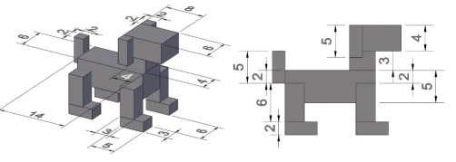

# WebGL Dog Scene

An interactive 3D scene written in plain **WebGL 1 / JavaScript**: a dog built only from cubes,
with camera controls, textures, a sky box, mouse control and animated actions.

Semester project for **Computer Graphics** (University of West Attica, Department of Informatics & Computer Engineering).
Following the assignment rules, the only libraries used are the lab ones: `gl-matrix-min.js` (glMatrix 2.0+) for
matrices and `webgl-debug.js` for WebGL error messages. Everything else is written from scratch.

The dog design given by the assignment:



## What the scene does

The scene is built step by step, as the assignment asks:

| Step | Requirement |
|---|---|
| 1 | Dark blue background. A cube with edge 2 (from -1 to 1 on every axis) centered at the origin, each face a different shade of green. |
| 2 | Camera at (5,5,5) looking at the origin, up = +y. Perspective: 90° field of view, aspect 1, near 0.01, far 20. |
| 3 | UI: a text box for the view angle (`cameraView`), a text box for the camera distance (`cameraDistance`), and 8 radio buttons (Left/Right × Bottom/Top × Back/Front) that place the camera at (±d, ±d, ±d). |
| 4 | A "Redraw" button that applies the UI values (far = 10 × cameraDistance, near = 0.001). |
| 5 | A **dog** made only of scaled/translated cubes (paws, legs, body, tail, neck, head, ears). It stands on the xy plane with height along +z. The paws span (-8,-6,0) to (8,6,0). Yellow shades for body/neck/head, red shades for legs/paws/tail/ears. |
| 6 | Animated **spiral camera orbit** around the dog (radius = cameraDistance, up = +z, far = 10000) with Start/Pause buttons. |
| 7 | **Textures** instead of colors: spotted dog fur for the body, a cartoon face for the head (eyes on top, muzzle on front). |
| 8 | A **sky box** (sky-textured cube with edge 5000) and a 25×25 **floor** textured with the author's name and student ID. |
| 9 | **Mouse control** of the camera: drag left/right rotates the camera, drag up/down changes its height. |
| 10 | Radio buttons (Head / Front-left leg / Front-right leg / Tail). The **mouse wheel** rotates the selected part around its joint and reverses automatically at the limits. Limits: head ±90°, legs 0–90°, tail ±90°. |
| 11 | Extra animated options: **Play dead**, **Static walk**, **Normal walk** (walk + move along +x), **Dachshund** (body stretches lengthwise), **Cartoon** (head lifts off the neck, tail spins 360°, paws inflate/deflate). They run automatically while the animation is on and are driven by the mouse wheel when it is paused. |

Mouse camera control (steps 9–11) also works when the animation is paused.

## How to run

**Online (nothing to install):** open the live demo:
<!-- Replace with your GitHub Pages address once it is published -->
`https://MarougkasOrfeas.github.io/WebGL/`

**On your computer:** first get the project, with `git clone`. Then open it through a small local web server:

- **VS Code (free):** install the free **Live Server** extension, open the project folder,
  right-click `index.html` → **Open with Live Server**. The page opens in your browser.
- Serve it with npx or python in the project folder ( npx serve or python -m http.server).

Prefer **Firefox** (the browser the project was made for) or any other modern browser with WebGL (Chrome, Edge, Safari).

> Double-click `index.html` wont work cause browsers block JavaScript modules, images used by WebGL and
> the translation file.

## How to use

The **start page** shows one card per group of steps. Each card opens the same scene page with the
features of those steps. Every page has a **Back to options** link and an **EN | ΕΛ** language switch.

| Card | Opens | What you see |
|---|---|---|
| Version 1 · Steps 1–4 | `html/scene.html?steps=1-4` | The green cube, the camera text boxes and positions |
| Version 2 · Step 5 | `html/scene.html?steps=5` | The yellow / red dog made of cubes |
| Version 3 · Steps 6–9 | `html/scene.html?steps=6-9` | Textured dog, sky box and floor, camera animation and mouse control |
| Version 4 · Steps 10–11 | `html/scene.html?steps=10-11` | Everything above, plus the dog parts and actions |
| Texture Generator | `html/texture-generator.html` | Draws the scene images and downloads them as PNG files |

**Controls on the scene page** (each page shows only the controls of its steps):

| Control | What it does |
|---|---|
| **cameraView** | View angle in degrees, from 1 to 179. |
| **cameraDistance** | Distance of the camera from the center, above 0 and up to 2000. A comma also works as the decimal point (`2,5`). A wrong value shows a message and a red border. |
| **Camera position** + **Redraw** | Places the camera at the selected position and draws the scene again (also stops the animation). |
| **Start / Pause** | Starts or stops the spiral camera animation. |
| **Drag with the left mouse button** | Left/right turns the camera around the dog, up/down changes its height. |
| **Mouse wheel over the canvas** | Moves the selected dog part, or the selected action while paused. Keep turning the same way: the movement turns back at its limits. |
| **Reset pose** | The dog stands still again. |

The scene images are included in `assets/textures/`. If one cannot be loaded, those parts of the scene are gray,
and the page shows a message with a link to the texture generator to create them again.

## Design decisions

Choices made :

- **Far limit from step 6 on:** the Redraw button uses far = 10000 on the step 6–11 pages too, as the
  10 × cameraDistance rule (e.g. 250) would cut away the 5000-wide sky box.
- **Dog layout:** the part sizes come from the assignment table; their positions are read from its figure.
  - The legs are beside the body.
  - The body is at height 6–11.
  - The tail is behind the body.
  - The ears are at the back of the head.
  
  The joints follow the assignment: neck base, middle of the leg top, and tail/body contact.
- **Front view:** from step 5 on there is an extra "Front view" camera position (the default) that shows the dog upright from the front.
- **Normal walk:** the dog walks forward 10 units, then starts again from -10, so it stays on the floor.
- **Selecting a dog option** restarts its action; angles set with the wheel stay until "Reset pose".
- **Floor thickness:** the floor is 1 unit thick (top at z = 0). With the very small near limit (0.001), a thin floor would flicker when seen from below.

## Project structure

```
index.html              start page
html/                   scene.html (shared page for all steps) + texture-generator.html
styles/                 base.css (colors, header), scene.css (scene pages), landing.css, tools.css
assets/textures/        fur, dog head atlas, sky, floor
assets/i18n/            translations.json (all UI texts, English + Greek)
assets/favicon.svg      page icon
js/
  lib/                  third-party: gl-matrix-min.js, webgl-debug.js
  config/               dimensions.js (dog parts, joints, sky box, floor, derived limits), options.js (camera positions, dog parts / actions)
  utils/                math.js, webgl.js (context, shaders, buffers, textures), dom.js (incl. input validation), i18n.js (translations), freeze.js
  graphics/             shaders.js, cube.js (the only geometry), camera.js (presets, orbit, matrices)
  scene/                dog.js (hierarchical dog), pose.js (steps 10–11), environment.js, textures.js
  app/                  scene-app.js (setup, drawing, Redraw), start-scene.js (starts a page from its settings), controls.js (builds the panels), animation.js, mouse.js, wheel.js
  pages/                entry scripts (index-page.js, scene-page.js reading ?steps=, texture-generator.js) + step-pages.js (settings of each group of steps)
docs/                   images for this README
```

The JavaScript uses ES modules. glMatrix and webgl-debug are loaded with plain `<script>` tags before the page module.
Every file starts with a short description, and every function and constant has a JSDoc comment.

## Translations

All UI texts are in `assets/i18n/translations.json`, one entry per key with both languages:

```json
"index.project.main.title": { "en": "Computer Graphics - Semester Project", "el": "Γραφικά Υπολογιστών - Εργασία Εξαμήνου" }
```

- In HTML, an element gets its text with `data-i18n="key"`. Use `data-i18n-html="key"` when the text contains markup, and `data-i18n-label="key"` for a screen reader label.
- In JavaScript, use `t("key")` from `js/utils/i18n.js`.
- The **EN | ΕΛ** switch changes the language without reloading. The choice is remembered on every page; English is the default.

To add a text: add the key with its `en` and `el` values to the JSON file, then reference it with `data-i18n` or `t()`.

